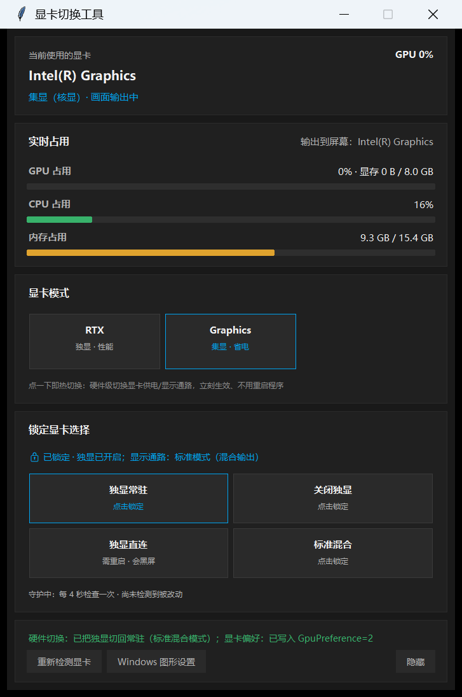

# GpuCore · 双芯

**华硕笔记本显卡热切换 + 资源监视。** 一个全局热键呼出面板，一秒钟换掉正在用的显卡——谁供电、谁渲染、谁驱动屏幕，都由你定。

[](LICENSE)


[](https://github.com/KKT446/GpuCore/releases/latest)



> 上图是真实渲染截图，不是设计稿。右下角常驻，`Ctrl+Alt+G` 呼出，再按一次收起。

---

## 为什么不是又一个"显卡切换器"

大部分叫这个名字的工具其实**不切换显卡**。它们只往注册表写一条偏好（`UserGpuPreferences`），然后监听新进程启动、把刚起来的程序重启一遍，好让 Windows 重新读这条偏好——**已经在跑的游戏，该用哪块卡还是哪块卡。**

GpuCore 走的是**厂商硬件通道**：通过华硕的 `\\.\ATKACPI` 接口，直接改**独显供电**和**显示通路（MUX）**。

| | 改注册表偏好 | **GpuCore（硬件通道）** |
|---|---|---|
| 生效时机 | 下次启动该程序 | **立刻** |
| 已经在跑的游戏 | 不受影响 | **换卡生效** |
| 需要重启程序 | 是（它帮你重启） | **否** |
| 需要管理员 | 否 | **否** |
| 适用机型 | 任何双显卡 Windows | 华硕（走 ACPI）；其他机型自动降级为注册表方案 |

同一个接口，奥创（Armoury Crate）和 G-Helper 用的也是它。

---

## 功能

### 四种模式

| 模式 | 做什么 | 生效 |
|---|---|---|
| **集显模式** | 关闭独显供电，最省电、最凉快 | 立刻 |
| **标准模式** | 独显通电 + 核显负责输出（混合模式，默认档） | 立刻 |
| **独显直连** | 独显直接驱动屏幕，性能最高 | **需要重启**（MUX 的物理限制） |
| **自动切换** | 插电开独显、用电池关独显 | 立刻 |

> 「独显直连」必须重启才生效——这是显示通路硬件开关的特性，G-Helper 也一样会帮你重启。
> GpuCore 会弹确认框，然后 3 秒后重启。切换过程中黑屏几秒是正常的，那是通路在重连。

### 资源监视

- **独显占用** + 显存用量（`nvidia-smi`）
- **核显占用**（Windows 性能计数器，直调 `pdh.dll`）
- **CPU 占用**、**内存占用**（Win32 原生调用，微秒级，不卡界面）
- **CPU 温度**（ACPI）

### 其他

- **全局热键**，默认 `Ctrl+Alt+G`，可自定义（点录制框直接按键，不用手打）
- **开机自启**，写 `HKCU\...\Run`
- **关闭窗口 = 收进后台**，不退出
- **常驻置顶**，停靠屏幕右下角

---

## 下载 / 安装

### 方式一：免安装版（推荐，别人用这个）

到 [Releases](https://github.com/KKT446/GpuCore/releases/latest) 下载 `GpuCore-x.y.z-portable.zip`（约 54 MB），解压到任意目录，双击 `GpuCore.exe`。

**目标机什么都不需要装**——包里自带整套 Python 3.12 运行时。不用管理员、不装驱动、不改系统设置。删掉文件夹就是卸载干净（记得先在设置里取消开机自启）。

### 方式二：从源码安装

```
右键 install.ps1 → 用 PowerShell 运行
```

或者命令行：

```powershell
powershell -ExecutionPolicy Bypass -File install.ps1
```

装到 `%LOCALAPPDATA%\GpuCore\`，不需要管理员权限，不会安装任何驱动。安装器会找到可用的 Python（找不到就用 winget 装）→ 复制文件 → 建桌面/开始菜单快捷方式 → **跑一次自检**，直接告诉你这台机器能不能用。

卸载：

```powershell
powershell -ExecutionPolicy Bypass -File install.ps1 -Uninstall
```

---

## 换台机器先跑自检

```powershell
python -m gpucore --check        # 源码方式
GpuCore.exe --check              # 免安装版
```

输出长这样：

```
==================================================================
  GpuCore (双芯) 自检  v1.0.0
==================================================================
  [ OK ] Python 版本
         3.12.10 @ C:\...\Python312\python.exe
  [ OK ] tkinter
         可用
  [ OK ] \\.\ATKACPI 通道
         可打开（普通用户权限即可）
  [ OK ]   设备 GPUEcoROG (独显供电)
         0x00090020 = 0
  [ OK ]   设备 GPUMuxROG (显示通路)
         0x00090016 = 1
  ...
  [ OK ] NVIDIA 独显
         nvidia-smi 可读，独显已通电
  [ OK ] 核显 LUID
         0x00000000_0x000110ab
  [ OK ] 全局热键通路
         RegisterHotKey 可用（试注册 Ctrl+Alt+G 成功）
------------------------------------------------------------------
  结果：全部通过 ✓
==================================================================
```

哪一项是 `[FAIL]`，就说明这台机器缺什么。反馈问题时把这段输出贴出来就行。

---

## 兼容性

| 机型 | 情况 |
|---|---|
| 华硕 ROG / TUF Gaming | 全部功能（设备号 `0x00090020` / `0x00090016`） |
| 华硕 VivoBook / Zenbook | 全部功能（设备号 `0x00090120` / `0x00090026`） |
| 其他华硕机型 | 启动时探测，探测到的功能才开放，探测不到的按钮置灰 |
| 非华硕 / 无独显 / 无 MUX | 监视照常，切换按钮置灰，不会误操作 |

程序**不会盲写**：探测不到固件通道就把按钮置灰，而不是试着写一个可能意义不明的设备号。

> 目前在 **ASUS TX Gaming FX608LM**（Core Ultra 7 255HX + RTX 5060 Laptop）上实测通过。
> 其他机型的实测反馈欢迎提 issue —— 跑一次 `GpuCore.exe --check` 把输出发出来即可。

---

## 依赖

**没有第三方依赖**，全部走 Windows 自带的 DLL：

| 用途 | 走什么 |
|---|---|
| 界面 | `tkinter`（Python 自带） |
| 显卡枚举 | `dxgi.dll`（ctypes 手写 COM 虚表） |
| 占用采集 | `pdh.dll`（性能计数器）+ `kernel32` |
| 全局热键 | `user32.dll` 的 `RegisterHotKey` |
| 硬件切换 | `kernel32` 的 `DeviceIoControl` → `\\.\ATKACPI` |
| 独显读数 | `nvidia-smi`（系统自带） |

不需要 `psutil`、不需要 `pystray`、不需要管理员。

---

## 常见问题

**点了没反应？**
先跑自检。如果 `\\.\ATKACPI 通道` 是 FAIL，说明这台机器没有华硕的 ACPI 驱动（装了 MyASUS 或 G-Helper 通常会带上）。

**切了显示没变？**
「独显直连」必须重启。切换后黑屏几秒是正常的——那是显示通路在重连。

**点了「独显直连」黑屏了？**
别慌，等它重启。已经黑了又不想重启，强制关机再开机也会回到可用状态。

**独显占用显示为 0 或"已断电"？**
集显模式下独显是真断电了，读不到是正常的。切回「标准模式」就会恢复。

**热键按不出来？**
可能被别的程序占了。去设置里点录制框，直接按一组新的组合键。

**杀毒软件报警？**
程序不联网、不装驱动、不改系统设置，只用系统自带的 DLL。免安装版里的 `GpuCore.exe` 是 `.NET Framework` 编译的启动器，唯一作用就是拉起包内的 Python——它没有签名，所以可能被拦。源码全在仓库里，可以自己编译。

---

## 项目结构

```
gpucore/                主程序
├── app.py              界面 + 采集 + ACPI
├── hardware.py         机型自适应层（不同华硕机型设备号不同，这里探测）
├── branding.py         名字/版本/路径，改名只改这里
├── selftest.py         --check 自检
└── tests/              自测套件（31 项，默认不碰硬件）
packaging/              免安装包：启动器源码 + 打包脚本
install.ps1             一键安装 / 卸载
assets/                 截图
docs/                   踩坑记录（换机器改代码前先看）
tools/                  诊断脚本
archive/                早期实现，仅作参考，不参与运行
```

### 自己跑自测

```powershell
python -m gpucore.tests.test_gpucore             # 31 项，只读，不碰硬件
python -m gpucore.tests.test_gpucore -k hotkey   # 只跑某一块
python -m gpucore.tests.test_gpucore --write     # 额外跑真的会切显卡的用例
```

默认路径**绝不写 ACPI**（有专门的用例守着这条红线），所以随时可以放心跑。

### 自己打包免安装版

```powershell
powershell -ExecutionPolicy Bypass -File packaging\build-portable.ps1
```

打包机需要一个完整的 Python 3.12 安装目录 + .NET Framework 的 `csc.exe`（Windows 自带）；打出来的包目标机什么都不需要。脚本会在干净环境里跑 `--check`、再真建一个窗口做冒烟测试才肯出包。

> 打 tag 推上去时（`git tag v1.0.0 && git push origin v1.0.0`），
> `.github/workflows/build-portable.yml` 会在 GitHub 上自动重打一份并挂到 Release。

---

## 致谢

硬件切换的具体流程——尤其是「写 ACPI 之前必须先结束占用独显的进程」这一条——参考了 [G-Helper](https://github.com/seerge/g-helper) 的实现，非常值得一看。

行为逻辑上参考过 [JasonHu051219/GPUSwitch](https://github.com/JasonHu051219/GPUSwitch) 的注册表偏好方案（GpuCore 在没有厂商通道的机器上会降级到同样的做法）。

## 许可

[MIT](LICENSE)
